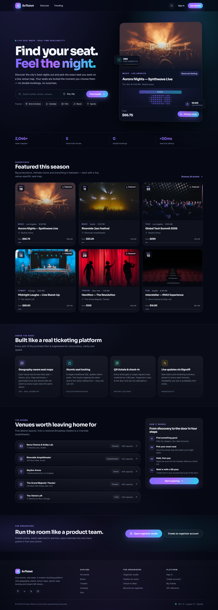
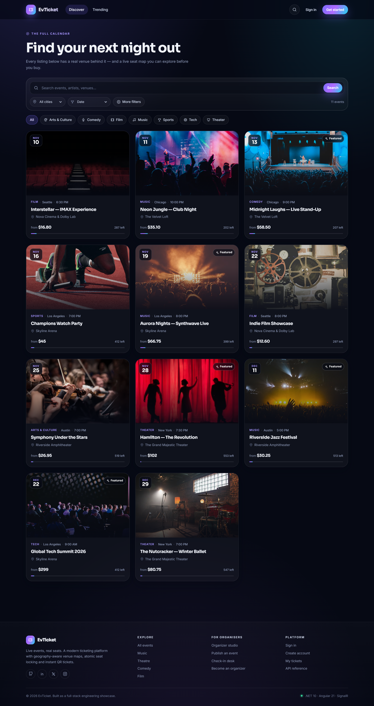
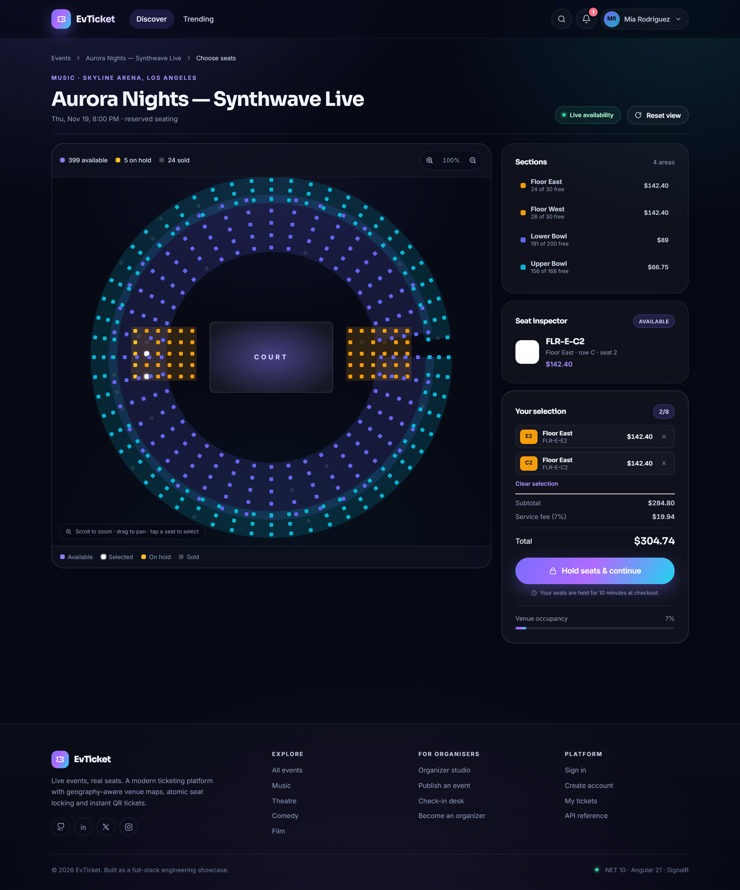
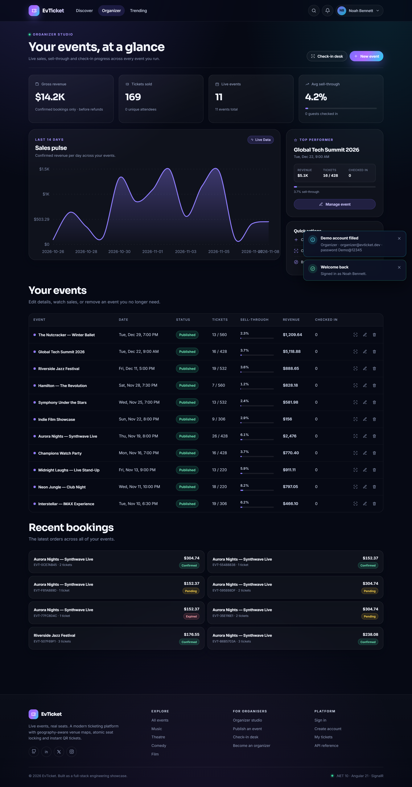
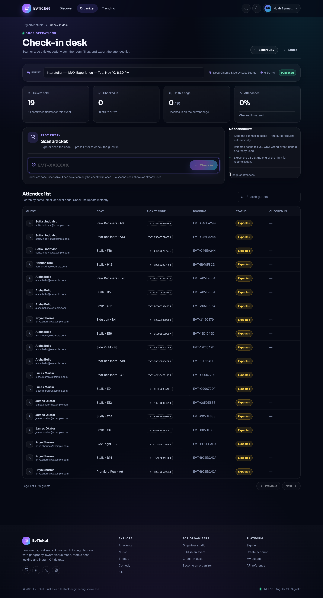
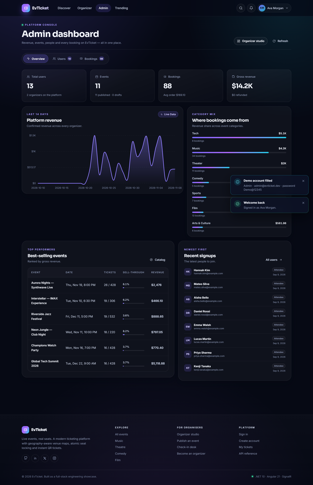
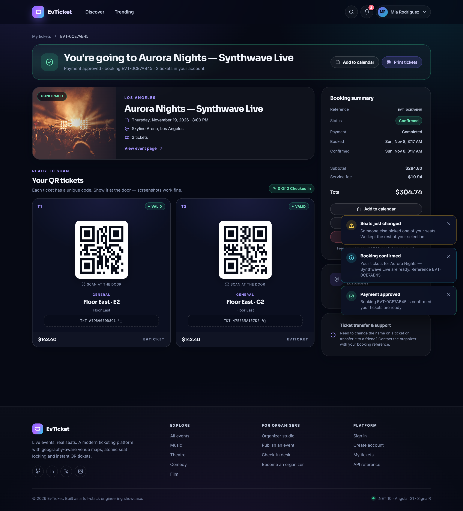

# EvTicket

A production-shaped ticketing platform built on **.NET 10** and **Angular 21**. Browse events, pick real seats on a geographic venue map, pay, and walk in with a QR ticket — while organizers and admins get the tools to run the whole show.

The core problem this project solves: **two people must never be able to buy the same seat**. EvTicket locks seats atomically the moment they are selected, holds them for 10 minutes, and streams availability to every open browser with SignalR.



---

## Table of contents

- [Highlights](#highlights)
- [Architecture](#architecture)
- [Tech stack](#tech-stack)
- [Repository layout](#repository-layout)
- [Getting started](#getting-started)
- [Demo accounts](#demo-accounts)
- [How seat locking works](#how-seat-locking-works)
- [Demo payments](#demo-payments)
- [Password reset without SMTP](#password-reset-without-smtp)
- [Testing](#testing)
- [Configuration](#configuration)
- [API reference](#api-reference)
- [Docker](#docker)
- [Continuous integration](#continuous-integration)
- [Screenshots](#screenshots)

---

## Highlights

**For guests**
- Discover events with search, category/city filters, price ranges and sorting.
- Interactive SVG venue maps: zoom, pan, section filtering, hover previews, live availability.
- Exact-seat checkout with a 10-minute hold timer, card validation and demo payments.
- QR tickets that are unique per ticket and become usable only once the booking is confirmed.
- Account area with upcoming/past tickets, profile editing and password changes.
- Live updates when other guests hold or release seats.

**For organizers**
- Studio dashboard with revenue, tickets sold, sell-through, attendance and a 14-day sales chart.
- Event create/edit with draft or publish states, venue and seating-layout selection, banner preview.
- Check-in desk: large code entry, success/rejection feedback, attendee search and CSV export.
- Per-event check-in progress and instant check-in updates.

**For admins**
- Platform console with revenue chart, category mix, top events and recent signups.
- Paginated user management: promote/demote organizers, delete accounts, search by name or email.
- Every booking on the platform, filterable by status and searchable, with CSV export.

**Engineering**
- Atomic seat holds through a single conditional `UPDATE` — no distributed locks, no race window.
- JWT access tokens plus rotating, hashed refresh tokens with reuse detection.
- Background worker expires abandoned holds and releases seats automatically.
- SignalR hub broadcasts seat and notification changes.
- Health checks, rate limiting, response compression, Problem Details, Scalar API docs.
- Demo data seeder with 5 hand-built venues, 11 events and ~80 confirmed bookings.
- Zoneless Angular with signals, standalone components, functional guards/interceptors and lazy routes.

---

## Architecture

```
┌─────────────────────────────────────────────────────────────┐
│                     Angular 21 SPA (browser)                │
│  signals · standalone components · zoneless · lazy routes   │
│  SVG seat maps · custom charts · QR rendering               │
└───────────────┬───────────────────────────┬─────────────────┘
                │ HTTPS / JSON              │ WebSockets
                ▼                           ▼
┌─────────────────────────────────────────────────────────────┐
│                       ASP.NET Core 10                       │
│  Controllers · JWT auth · rate limiting · validation        │
│  AuthService · BookingService · EventService · TicketService│
│  AnalyticsService · SeatHoldExpiryWorker · SignalR SeatHub  │
└───────────────┬─────────────────────────────────────────────┘
                │ EF Core 10
                ▼
┌─────────────────────────────────────────────────────────────┐
│        SQLite (demo/local)  ·  SQL Server (production)      │
│  Users · Events · Venues · Sections · Seats · Bookings ·    │
│  BookingItems · Tickets · Payments · RefreshTokens · ...    │
└─────────────────────────────────────────────────────────────┘
```

**Booking lifecycle**

```
seats selected ──► hold (pending, 10 min) ──► checkout ──► confirmed
                        │                        │
                        │ expired by worker      │ cancelled by guest
                        ▼                        ▼
                     released                  refunded + seats freed
```

---

## Tech stack

| Layer | Choices |
| --- | --- |
| API | .NET 10, ASP.NET Core controllers, Minimal hosting, Problem Details, Scalar/OpenAPI |
| Data | EF Core 10, SQLite (demo) / SQL Server (production), code-first migrations |
| Identity | ASP.NET Core Identity, JWT bearer, rotating refresh tokens (SHA-256 hashed) |
| Realtime | SignalR with JWT query-string auth for the hub |
| Frontend | Angular 21, standalone components, signals, zoneless change detection, SCSS design system |
| Frontend UX | Custom SVG seat maps and charts, `qrcode` for passes, functional interceptors/guards |
| Tooling | Vitest unit tests, GitHub Actions, Docker multi-stage build, Docker Compose |

---

## Repository layout

```
EvTicket/
├─ api/
│  ├─ EvTicket.Api/            # .NET 10 Web API
│  │  ├─ Common/               # ApiException, CurrentUser
│  │  ├─ Contracts/            # Request/response DTOs
│  │  ├─ Controllers/          # Auth, Events, Bookings, Tickets, Dashboard, Notifications
│  │  ├─ Data/                 # DbContext, migrations, seeder, venue catalog
│  │  ├─ Domain/               # Entities and enums
│  │  ├─ Hubs/                 # SeatHub
│  │  ├─ Middleware/           # Exception handling
│  │  ├─ Services/             # Auth, events, bookings, tickets, analytics, email, realtime
│  │  └─ Workers/              # SeatHoldExpiryWorker
│  └─ EvTicket.Api.Tests/      # xUnit + WebApplicationFactory integration tests
├─ web/                        # Angular 21 application
│  └─ src/app/
│     ├─ core/                 # Models, services, guards, interceptors, formatting
│     ├─ features/             # Home, events, seat map, checkout, account, auth, organizer, admin
│     └─ shared/               # Header, footer, cards, charts, QR, auth shell, icons
├─ docs/                       # Architecture notes and screenshots
├─ EvTicket.slnx               # Solution (API + integration tests)
├─ Dockerfile                  # Web build → API publish → runtime image
├─ docker-compose.yml
└─ .github/workflows/ci.yml
```

---

## Getting started

### Prerequisites

- [.NET 10 SDK](https://dotnet.microsoft.com/download)
- [Node.js 22+](https://nodejs.org/) and npm 10+
- Optional: Docker Desktop

### 1. Run the API

```powershell
cd api/EvTicket.Api
dotnet restore
dotnet run --launch-profile http
```

The API starts on **http://localhost:5080**. On first run it applies migrations and seeds the demo catalogue into `evticket.db` (SQLite).

> `Jwt:Key` is required and must be at least 32 characters. Development uses a clearly marked dev-only key from `appsettings.Development.json`; set `Jwt__Key` for anything else.

### 2. Run the web app

```powershell
cd web
npm ci --legacy-peer-deps
npm start
```

Open **http://localhost:4200**. `--legacy-peer-deps` is required because npm 10.9 has a peer-dependency resolution bug with the Vitest toolchain used by Angular 21.

### 3. Or run the whole thing in Docker

```powershell
copy .env.example .env    # set a real JWT_KEY
docker compose up --build
```

Open **http://localhost:8080**. The container serves the built Angular app and the API from the same origin, with SQLite data persisted in a named volume.

---

## Demo accounts

All seeded accounts use the password **`Demo@12345`**.

| Role | Email | What to try |
| --- | --- | --- |
| Admin + Organizer | `admin@evticket.dev` | Admin console, platform analytics, user management |
| Organizer | `organizer@evticket.dev` | Organizer studio, create events, check-in desk |
| Attendee | `demo@evticket.dev` | Buy seats, view QR tickets, manage bookings |

The sign-in page also has one-click buttons that fill these credentials.

---

## How seat locking works

Double booking is prevented at the database level, not with in-process locks:

1. **Hold** — the client posts the exact seat IDs. The API runs one conditional update:

   ```sql
   UPDATE Seats
   SET Status = 'Held', HeldUntil = @expiry, HeldByBookingId = @booking
   WHERE Id IN (...) AND Status = 'Available';
   ```

   `ExecuteUpdateAsync` returns the number of affected rows. If it does not equal the number of requested seats, the whole request fails with **409 `seats_taken`** and any rows already taken by this request are rolled back. Two concurrent requests cannot both win the same row.

2. **Checkout** — payment is validated, then the booking's held seats are moved to `Sold` with another conditional update constrained to `Status = 'Held' AND HeldByBookingId = @booking`. Only then is the booking confirmed and one unique ticket per seat issued. If the hold expired or was lost, checkout returns **409 `hold_expired`**.

3. **Expiry** — `SeatHoldExpiryWorker` sweeps expired pending bookings, marks them `Expired` and returns their seats to `Available`. Abandoned carts never block inventory.

4. **Realtime** — every status change is broadcast on `/hubs/seats`. Open seat maps update without polling.

General-admission events skip individual seats but use the same conditional stock update, so overselling is prevented the same way.

### Try the race yourself

1. Open the same seated event in two browsers and sign in as two different users.
2. Select the same seat in both.
3. Press **Continue** in both tabs. One succeeds and opens checkout; the other immediately receives *"Those seats were just taken"* and refreshes the map.
4. Leave a hold to expire (10 minutes) and watch the seat return automatically.

---

## Demo payments

Payments run in demo mode (`Payments:Mode = Demo`), so no real provider is called.

- Use **any Luhn-valid card number** with a future expiry and 3–4 digit CVV.
- `4242 4242 4242 4242` · `12/30` · `123` works.
- A card ending in **`0002`** deliberately returns **402 Declined** so the failure path is demoable.
- The **demo wallet** option skips card fields and always succeeds.

---

## Password reset without SMTP

Email delivery is disabled by default (`Email:Enabled = false`). Requesting a reset still generates a real, single-use Identity token and logs the full link at Information level:

```
Email disabled. Password reset link for demo@evticket.dev: http://localhost:4200/reset-password?email=...&token=...
```

Copy that link from the API console to complete the reset flow. With SMTP configured, the same link is sent by email instead.

---

## Testing

```powershell
# API integration tests (real pipeline, temporary SQLite database)
dotnet test EvTicket.slnx

# Web unit tests
cd web
npm test -- --watch=false
```

The integration suite uses `WebApplicationFactory<Program>` to boot the actual API — middleware, Identity, EF Core, seeding, and the seat-locking SQL — against a throwaway SQLite file. It currently proves:

- two users racing for the same seat get exactly one `200` and one `409 seats_taken`;
- a demo-wallet checkout flips the booking to `confirmed`, marks the payment `completed`, and issues a `TKT-…` ticket.

---

## Configuration

Configuration comes from `appsettings.json`, environment variables (double underscore for nesting) and local secrets.

| Setting | Default | Purpose |
| --- | --- | --- |
| `Jwt__Key` | dev-only key | Signing key, minimum 32 characters |
| `Jwt__AccessTokenMinutes` | `60` | Access-token lifetime |
| `Jwt__RefreshTokenDays` | `14` | Refresh-token lifetime |
| `ConnectionStrings__Default` | `Data Source=evticket.db` | SQLite path or SQL Server connection |
| `Database__Provider` | `Sqlite` | `Sqlite` or `SqlServer` |
| `App__PublicUrl` | `http://localhost:4200` | Base URL used in emails |
| `App__SeatHoldMinutes` | `10` | How long a hold survives |
| `App__ServiceFeeRate` | `0.07` | Checkout service fee |
| `App__MaxSeatsPerOrder` | `8` | Maximum seats in one order |
| `Cors__Origins__0` | `http://localhost:4200` | Allowed browser origin |
| `CORS_ORIGINS` | — | Comma-separated extra origins |
| `Seed__Enabled` | `true` | Seed demo data on startup |
| `Seed__DemoPassword` | `Demo@12345` | Password for seeded accounts |
| `Email__Enabled` | `false` | Enable real SMTP delivery |
| `Payments__Mode` | `Demo` | Payment provider mode |

To use SQL Server, set `Database__Provider=SqlServer` and a SQL Server connection string, then apply migrations:

```powershell
dotnet ef database update --project api/EvTicket.Api
```

---

## API reference

Interactive docs are available in Development:

- **Scalar UI:** http://localhost:5080/scalar/v1
- **OpenAPI JSON:** http://localhost:5080/openapi/v1.json
- **Health:** http://localhost:5080/health

Main groups:

| Group | Routes |
| --- | --- |
| Auth | `/api/auth/register`, `/login`, `/refresh`, `/logout`, `/forgot-password`, `/reset-password`, `/me` |
| Catalog | `/api/events`, `/api/events/featured`, `/api/events/{idOrSlug}`, `/api/catalog/categories`, `/api/catalog/venues` |
| Seats & booking | `/api/events/{idOrSlug}/seat-map`, `/api/bookings/hold`, `/api/bookings/{id}/checkout`, `/release`, `/cancel` |
| Tickets | `/api/tickets/check-in`, `/api/tickets/event/{eventId}`, `/api/tickets/event/{eventId}/export` |
| Organizer | `/api/events/organizer/mine`, `/api/dashboard/organizer` |
| Admin | `/api/events/admin/all`, `/api/bookings/admin/all`, `/api/dashboard/admin`, `/api/dashboard/users` |
| Realtime | `/hubs/seats` |

All DTOs are camelCase; enums are serialised as lowercase strings.

---

## Docker

The root `Dockerfile` builds three stages:

1. `node:22-alpine` builds the Angular production bundle.
2. `dotnet/sdk:10.0` restores and publishes the API, copying the SPA into `wwwroot`.
3. `dotnet/aspnet:10.0` runs a single same-origin container with a health check.

```powershell
docker compose up --build -d
docker compose logs -f app
```

Data persists in the `evticket-data` volume. Reset it with `docker compose down -v`.

> The Compose file ships with a development fallback key so it runs out of the box. Replace `JWT_KEY` in `.env` before exposing the stack anywhere public.

---

## Continuous integration

`.github/workflows/ci.yml` runs on every push and pull request:

- **API:** restore, Release build, and xUnit integration tests on the .NET 10 SDK. The suite boots the real pipeline against a temporary SQLite file and proves that two simultaneous holds on the same seat yield exactly one `200` and one `409`, and that a demo-wallet checkout confirms the booking and issues a ticket.
- **Web:** `npm ci --legacy-peer-deps`, unit tests, production build on Node 22.

---

## Screenshots

| Browse & discover | Geographic seat map |
| --- | --- |
|  |  |

| Organizer studio | Check-in desk |
| --- | --- |
|  |  |

| Admin console | QR ticket |
| --- | --- |
|  |  |

---

## Notes & next steps

- The demo seeder is idempotent and safe to rerun; it only creates data when the database is empty.
- Stripe, Google sign-in and SMTP are wired as configuration seams (`Payments`, `Google`, `Email`) but intentionally run in demo/disabled mode.
- Production hardening ideas: move refresh tokens to HttpOnly cookies, add Redis-backed SignalR scale-out, add OpenTelemetry traces, and replace the demo payment gateway with Stripe webhooks.

Built as an end-to-end portfolio project: real concurrency control, real-time UX, and an interface that treats both guests and operators as first-class users.
